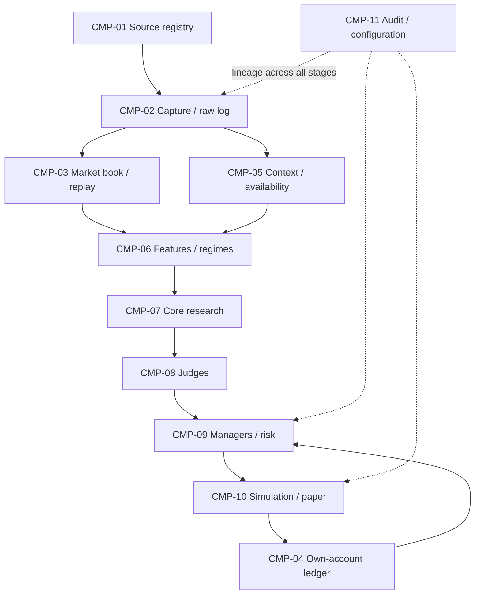

# Architecture map — pending v1.0 source

[Documentation index](../README.md) · [Component register](../traceability/components.md) · [Contract checklist](contracts.md)

**Status:** proposed navigation and responsibility map, created from the accessible brief. It is not the missing v1.0 architecture. Component names below are provisional workspace labels.

## Meaning of order flow and ledger

A market feed can expose specified orders, book levels, trades and venue events. It is not evidence of access to all participants' balances, intentions or transfers. Nasdaq's ITCH specification describes exchange order and trade messages within that feed's scope ([EXT-001](https://www.nasdaqtrader.com/content/technicalsupport/specifications/dataproducts/NQTVITCHSpecification_5.0.pdf)). Coinbase documents separate market channels and an authenticated user channel ([EXT-002](https://help.coinbase.com/en/developer-platform/websocket-feeds/exchange)).

The design implication is to document visibility per source, rather than infer a universal money ledger. Order-book events, executed volume, a raw event journal and the system's own account ledger serve different purposes. Lower rendering delay alone does not establish an informational advantage; any latency claim must be measured for selected sources.

## Proposed flow

The diagram is a proposed logical relationship, not an implemented service topology. The ledger feedback is simulated state for this roadmap. External account credentials, order routes and live execution are absent.

## Component boundaries

| Group | Responsibility | Boundary question for baseline |
| --- | --- | --- |
| CMP-01 / CMP-02 | Source catalog, capture, raw provenance and normalized events | Which asset/venue, rights and feed semantics? |
| CMP-03 | Reconstruct only the market state supported by each feed; replay it | Price-level or order-level data? Recovery guarantees? |
| CMP-04 | Account for simulated cash, positions, fills and fees separately | What did “ledger” mean in original v1.0? Which accounting convention? |
| CMP-05 / CMP-06 | Track context knowledge time, features and regime uncertainty | Which contexts and hypotheses have measurable relevance? |
| CMP-07 / CMP-08 / CMP-09 | Research candidates, assess evidence and apply risk decisions | Do these proposed responsibilities match the original role definitions? |
| CMP-10 | Simulate and later assess paper-only behaviour | Which fill, queue, latency and cost assumptions are defensible? |
| CMP-11 | Record lineage, policy/config versions, incidents and evidence | Which records are required for reproducibility and recovery? |

## Proposed invariants

- Every derived value identifies its source events, schema and transformation version.
- Unknown, stale and invalid states remain explicit; no consumer silently treats them as valid.
- Knowledge available after a decision cannot enter that decision's replay inputs.
- Book state and own-account accounting have distinct contracts and reconciliation rules.
- Model output cannot bypass deterministic risk rules or create an external order.
- An abstention has a reason and lineage, just as a research candidate does.

These are proposed acceptance requirements to reconcile at G00 and specify at G01–G05. They are not verified system properties. Storage engines, programming languages, infrastructure and model families are intentionally unresolved until originals and research justify selections.
