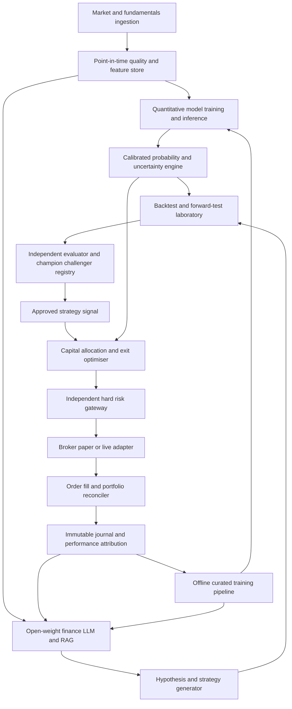

# 02 — Architecture and service boundaries

## Core stages (complete chain)

## Trust boundaries
1. **Untrusted:** market news, filings, RAG documents, third-party APIs, agent text; treat as data, never instructions.
2. **Research zone:** model tools can query data, backtest, propose and journal. No production credentials.
3. **Policy zone:** allocator produces structured requests; risk gateway validates against independently configured, versioned policy.
4. **Execution zone:** only broker adapter can place/cancel orders, using scoped credentials; paper and live accounts are physically/logically separated.
5. **Operator zone:** human approvals for initial activation, model promotion, budget increases, deposits and policy changes.

## Service responsibilities
- **Market-data:** ingest, dedupe, correct, version, tag `event_time` vs `available_at` and publish clean bars/quotes.
- **Feature/quant:** causal features, train forecasts, uncertainty, calibration; no direct order permissions.
- **Research LLM:** propose hypotheses and summarise evidence using tools and RAG; cannot assign arbitrary verified probabilities.
- **Strategy lab:** ten independent policy configurations, backtests and paper ledgers; enforce experiment budgets.
- **Evaluator:** immutable holdout evaluation, multiple-testing controls, baseline comparison, drift and promotion decisions.
- **Allocator:** maximise conservative expected portfolio utility within budget and exposure constraints.
- **Risk gateway:** hard limits, duplicate-order protection, no-trade guards, order policy validation, emergency halt.
- **Reconciler:** broker is source of truth for actual open positions/orders; detect and resolve mismatches.
- **Journal:** append-only forecast, decisions, execution and post-mortems; training datasets generated offline after audit.

## Deployment principle
A cheap CPU VPS can host ingestion, database and basic quant inference. Run LLM inference and LoRA training on-demand or on owned suitable hardware; **do not assume** a £20/month budget includes always-on GPU compute. Begin with deterministic quant baselines and offline LLM research.

## Event sequencing
1. Bar/quote arrives; reject if stale or missing required fields.
2. Compute features using only information available as of decision time.
3. Quant models output return distribution, regime, calibration metadata and confidence bounds.
4. Approved strategy emits proposed direction, entry, stop, target, expiry and horizon.
5. Allocator compares no-trade, hold, enter, reduce, close and add decisions after costs.
6. Risk gateway authorises a bounded order or rejects with a machine-readable reason.
7. Broker places protective orders where supported; verify acknowledgement and actual state.
8. Reconcile fills, positions and cash; write audit events.
9. On schedule, evaluator analyses results and generates challenger proposals for offline validation.
